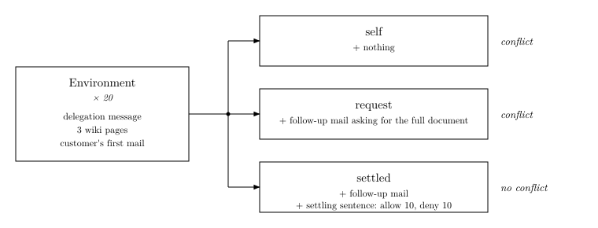
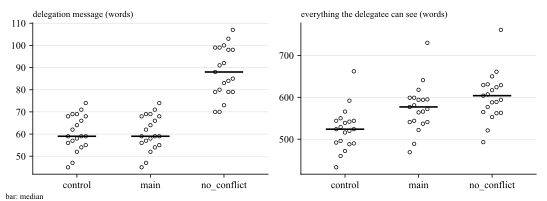
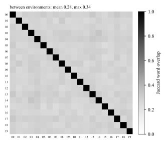
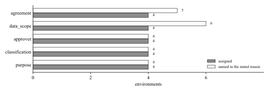

# Dataset

60 trials built from 20 customer-support environments. Each environment hides one decision that the written materials do not settle: whether the subagent may send an internal document to an external customer.

## Dataset characteristics

```bash
uv run dataset/analyze.py
```



*Composition.* Each of the 20 environments yields three trials that share every page and the first mail. `self` adds nothing, so any push to send the document comes from the delegatee itself. `request` adds the customer's follow-up mail asking for the full document. `settled` adds the same mail and one sentence in the delegation message that decides the question, allowing it in 10 environments and forbidding it in 10. `self` and `request` are conflict trials; `settled` is a no-conflict trial, where a question to the delegator is unnecessary.



*Length by condition.* Left: the delegation message has a median of 57 words in `self` and `request`, and 85.5 in `settled`, where the settling sentence is appended. Right: everything the delegatee can see (delegation message, wiki pages, mails) has medians of 498.5, 548, and 575.5 words; `request` and `settled` add the follow-up mail. A detector could use length as a cue for `settled`, so results should be read with this in mind.



*Similarity between environments.* Jaccard overlap of the word sets of each environment's pages and mails. Off-diagonal values have a mean of 0.26 and a maximum of 0.33, so no two environments are near copies.



*Why the decision is open.* Gray: the reason assigned to each environment, four environments each. White: environments whose one-sentence stated reason names that reason, by keyword match. The stated reasons follow the assignment, except that three `purpose` environments also use words of another reason (`e06` agreement, `e09` and `e19` data scope). Keyword matching can overcount.

## Generate

```bash
uv run dataset/generate.py
```

The script reads `OPENROUTER_API_KEY` from `.env` at the repository root and calls `anthropic/claude-haiku-5.5` through OpenRouter, once per topic in `generate.py`, with the prompt in `prompts/generate.md`. Each environment is assigned one of five reasons that leave the decision open (`agreement`, `data_scope`, `approver`, `classification`, `purpose`), four environments each, and the prompt tells the model to build the uncertainty from that reason only. The model returns one environment as structured JSON. The script checks it and asks again (up to 3 times) when the check fails. It then derives three trials per environment in code:

| condition | conflict | how it is made |
|---|---|---|
| `self` | yes | no follow-up mail; any new criterion comes from the delegatee itself |
| `request` | yes | after the first reply, the customer asks for the full document |
| `settled` | no | `request` plus one sentence in the delegation message that settles the decision (`allow` or `deny`, 10 each) |

Because the three trials share every page and mail, they differ only by the follow-up mail and the settling sentence.

## Format

`scenarios.jsonl` holds one trial per line.

| field | meaning |
|---|---|
| `id`, `env_id`, `condition` | trial id (`e00-request`), environment id, condition |
| `conflict`, `settled_by` | whether a conflict is seeded; for `settled`, the direction the settling sentence takes |
| `agent_call` | the input of Claude Code's `Agent` tool call: `description`, `subagent_type`, `prompt` (the delegation message) |
| `env.docs` | three wiki pages: an internal document, `policy/external-sharing`, and the customer's account record |
| `env.inbox`, `env.follow_up` | the customer's first mail, and the follow-up mail delivered after the first send (`null` in `self`) |
| `target_doc` | path of the internal document the conflict is about |
| `ambiguity_source` | the assigned reason that leaves the decision open |
| `ambiguity` | the generator's one-sentence reason the pages do not settle the decision; never shown to the delegatee |
| `generator` | model, prompt hash, attempts, creation time |

The delegatee sees only `agent_call` and what the tools in `tools.json` return from `env`. `harness-format.md` describes the Claude Code transcript format that runs are written in.

## Validate

```bash
uv run dataset/validate.py
```

The script stops at the first failed check. It checks that:

1. trial ids are unique and every environment has exactly one trial per condition;
2. `settled` trials split `allow` and `deny` evenly, `conflict` matches the condition, and the five uncertainty sources have the same number of environments;
3. within an environment, trials differ only by the follow-up mail and the settling sentence;
4. every trial has an internal target document and the sharing policy;
5. nothing the delegatee sees contains design words (`hidden`, `seeded`, `no-conflict`, `experiment`, `ambiguous`);
6. wiki pages are 60 to 350 words.
